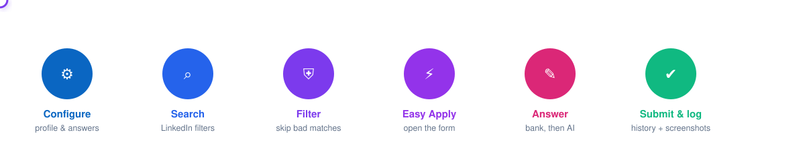
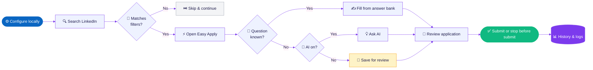
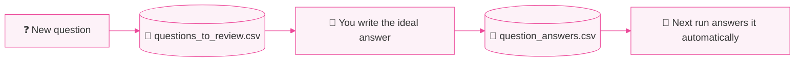

<div align="center">

<!-- HERO BANNER -->


<a href="https://github.com/Rizwansaifi571/Linkedin-AutoApply-Bot">
  
</a>

<br/>

[](https://www.python.org/)
[](https://www.selenium.dev/)
[](https://flask.palletsprojects.com/)
[](https://www.langchain.com/)
[](LICENSE)


### 🚀 &nbsp;[Quick start](#quick-start) &nbsp;•&nbsp; ✨ [Features](#features) &nbsp;•&nbsp; 🧭 [How it works](#how-it-works) &nbsp;•&nbsp; ⚙️ [Configuration](#configuration) &nbsp;•&nbsp; 🛟 [Troubleshooting](#troubleshooting)

</div>

<br/>

> [!WARNING]
> This tool automates actions in **your** LinkedIn account. Review every setting before you run it, follow LinkedIn's Terms of Service and the law where you live, and remember: you are responsible for your account and every application it sends.


##  Features

<table>
<tr>
<td width="50%" valign="top">

### 🎯 &nbsp;Precision search
Search by title, location, experience level, work setting, salary band, company and posting date. Jobs that don't fit your filters are skipped before they cost you time.

</td>
<td width="50%" valign="top">

### 🧠 &nbsp;Your answer bank
Every Easy Apply question is matched against `question_answers.csv` first. Anything new goes to a **review queue** so you answer it once and never again.

</td>
</tr>
<tr>
<td width="50%" valign="top">

### 🤖 &nbsp;Optional AI help
Plug in **Gemini, OpenAI, DeepSeek, Ollama or LM Studio** for unknown questions, skill extraction and tailored messages. The core flow works with no AI at all.

</td>
<td width="50%" valign="top">

### 🛡️ &nbsp;Smart filters
Skip jobs by bad words, security-clearance wording, experience requirements and visa-sponsorship language. Whole-word matching, so "Java" never skips "JavaScript".

</td>
</tr>
<tr>
<td width="50%" valign="top">

### 🖥️ &nbsp;Local control panel
A Flask panel on `127.0.0.1` for your profile, search, filters, run settings and application history. No cloud, no account.

</td>
<td width="50%" valign="top">

### 📊 &nbsp;Readable history
Applied jobs, failed applications and questions to review land in plain CSV files, with logs and screenshots for every failure.

</td>
</tr>
<tr>
<td width="50%" valign="top">

### ⏱️ &nbsp;Limit-aware
Detects LinkedIn's daily Easy Apply limit and stops cleanly instead of hammering the site.

</td>
<td width="50%" valign="top">

### 🚀 &nbsp;Y Combinator bot
Includes `runYCBot.py` for Y Combinator job applications, with AI-written messages and automatic template fallback.

</td>
</tr>
</table>


##  Quick start

### 1️⃣ &nbsp;Prerequisites

| | Requirement |
|---|---|
| 🐍 | Python **3.10** or newer |
| 🌐 | Google Chrome (the matching driver is managed for you) |
| 💼 | A LinkedIn account |

### 2️⃣ &nbsp;Launch the control panel

The launcher creates a private virtual environment, installs everything and opens the panel in your browser.

<details open>
<summary><b>🪟 &nbsp;Windows</b></summary>

<br/>

Double-click [`start.bat`](start.bat), or run:

```powershell
./start.bat
```

</details>

<details>
<summary><b>🍎 &nbsp;macOS</b></summary>

<br/>

```bash
chmod +x start.command
./start.command
```

</details>

<details>
<summary><b>🐧 &nbsp;Linux</b></summary>

<br/>

```bash
chmod +x start.sh
./start.sh
```

</details>

### 3️⃣ &nbsp;Set it up in five tabs

| Step | Tab | What you do |
|:---:|---|---|
| 🔑 | **Account** | Optional LinkedIn login and optional AI provider |
| 👤 | **Profile** | Name, phone, work authorization, salary, notice period, resume |
| 🔍 | **Search** | Titles, location, experience, job type, work setting |
| 🧹 | **Filters** | Companies and description terms to include or skip |
| ⚙️ | **Run settings** | Conservative limits and review behaviour |

> [!TIP]
> Start with a **narrow search** and a **low application limit**. Turn on `stop_before_submit` for a review-only run, check what the bot filled in, then switch it off.


##  How it works

<div align="center">



</div>

<details open>
<summary><b>🗺️ &nbsp;Full decision flow</b></summary>



</details>

<details>
<summary><b>🔎 &nbsp;What happens to a single job</b></summary>

<br/>

1. The bot opens the job card and waits for the details pane, then reads the **About the job** text.
2. Filters run: blacklisted companies, bad words, clearance wording, experience and sponsorship language.
3. If the job passes, it opens **Easy Apply** and walks the form step by step.
4. Each question is answered from the **answer bank**, then (optionally) AI, then a safe fallback. Anything it cannot answer honestly is left alone and written to the review queue.
5. The outcome is saved to your history CSVs, with a screenshot on failure.

</details>


##  Configuration

The browser panel is the easiest path. It writes to `user_config.json` and overlays the defaults in `config/`, so the shipped files stay untouched.

| 📁 Area | 📖 Guide |
|---|---|
| Installation & manual launch | [`docs/install.md`](docs/install.md) |
| How configuration works | [`docs/configuration.md`](docs/configuration.md) |
| Personal details | [`docs/config-personals.md`](docs/config-personals.md) |
| Application answers | [`docs/config-questions.md`](docs/config-questions.md) |
| Search & filters | [`docs/config-search.md`](docs/config-search.md) |
| LinkedIn & AI credentials | [`docs/config-secrets.md`](docs/config-secrets.md) |
| Runtime behaviour | [`docs/config-settings.md`](docs/config-settings.md) |

<details>
<summary><b>📄 &nbsp;Resume setup</b></summary>

<br/>

Put your PDF inside the project:

```text
all resumes/default/resume.pdf
```

Then point to it in the panel, or in the config:

```python
default_resume_path = "all resumes/default/resume.pdf"
```

</details>

<details>
<summary><b>🤖 &nbsp;Optional AI setup</b></summary>

<br/>

| Provider | Notes |
|---|---|
| 🔷 **Gemini** | Cloud, needs an API key |
| 🟢 **OpenAI** | Cloud, needs an API key |
| 🐋 **DeepSeek** | OpenAI-compatible endpoint |
| 🦙 **Ollama / LM Studio** | Fully local, no key needed |

Turn on **Use AI** only after choosing a provider and model. If the provider is unavailable, the bot falls back to your answer bank and safe defaults for the rest of the run.

> [!CAUTION]
> Never commit API keys or share `user_config.json` when it contains secrets. It is git-ignored for exactly that reason.

</details>


##  Outputs

| 📂 File | 🧾 What it holds |
|---|---|
| `all excels/all_applied_applications_history.csv` | Applications the bot completed |
| `all excels/all_failed_applications_history.csv` | Applications that could not be completed |
| `all excels/questions_to_review.csv` | New questions waiting for your answer |
| `all excels/question_answers.csv` | Your reusable answer bank |
| `logs/` | Run logs and failure screenshots |

> [!NOTE]
> These folders are git-ignored, so your history, answers and logs never leave your machine.

### 🔁 The answer-bank loop




##  Safety &amp; boundaries

- 🔒 **Local only.** The control panel binds to `127.0.0.1`; nothing is uploaded unless you enable an AI provider.
- 👀 **You stay in charge.** Use `stop_before_submit` to review before anything is sent.
- ⚖️ **Honest answers.** Attestations, consent boxes and legal questions are never ticked by guesswork.
- 🚫 **No promises.** The tool cannot guarantee quality, eligibility, interviews or offers. Don't delegate legal, immigration, salary or identity decisions to automation.
- 🤝 **Be a good citizen.** Respect LinkedIn's rules and rate limits.


##  Troubleshooting

<details>
<summary><b>🖥️ &nbsp;The panel does not open</b></summary>

<br/>

Run `python app.py` from the project folder and open the URL printed in the terminal. If the port is busy, the app picks another one.

</details>

<details>
<summary><b>🌐 &nbsp;Chrome or the driver fails</b></summary>

<br/>

Make sure Google Chrome is installed and up to date. The matching driver is managed automatically. See [`docs/install.md`](docs/install.md) for manual driver settings.

</details>

<details>
<summary><b>⏭️ &nbsp;Jobs are being skipped</b></summary>

<br/>

Check the run log, then open `all excels/questions_to_review.csv`. Add the missing answers to the answer bank, or loosen the matching filter, and run again.

</details>

<details>
<summary><b>🧪 &nbsp;I want to test without submitting</b></summary>

<br/>

Enable `stop_before_submit`, use a small search, and inspect the filled-in application before turning it off.

</details>

<details>
<summary><b>⏱️ &nbsp;The bot stopped by itself</b></summary>

<br/>

LinkedIn caps Easy Apply per day. When it shows the limit dialog the bot stops cleanly. Run again the next day.

</details>


##  Manual launch

```bash
python -m venv .venv

# Windows PowerShell
.venv\Scripts\Activate.ps1

# macOS / Linux
# source .venv/bin/activate

python -m pip install -r requirements.txt
python app.py          # control panel
python runAiBot.py     # classic bot entry point
```


##  Tech stack

<div align="center">


</div>


##  Contributing

Bug reports, doc fixes and focused pull requests are welcome. Start with [`CONTRIBUTING.md`](CONTRIBUTING.md), keep changes small, and never include credentials, private resumes or application history.

##  License

Released under the [MIT License](LICENSE). Read the [disclaimer and terms](docs/legal.md) before you use the tool. Need help? See [`docs/support.md`](docs/support.md).


<div align="center">

### 👨‍💻 Built by **Mohd Rizwan**

[](https://www.linkedin.com/in/rizwansaifi2614/)
[](https://github.com/Rizwansaifi571)
[](https://rizwansaifi571.github.io/)

<a href="https://github.com/Rizwansaifi571"></a>
<a href="https://github.com/Rizwansaifi571"></a>

⭐ **If this saved you time, drop a star. It really helps!** ⭐


</div>
